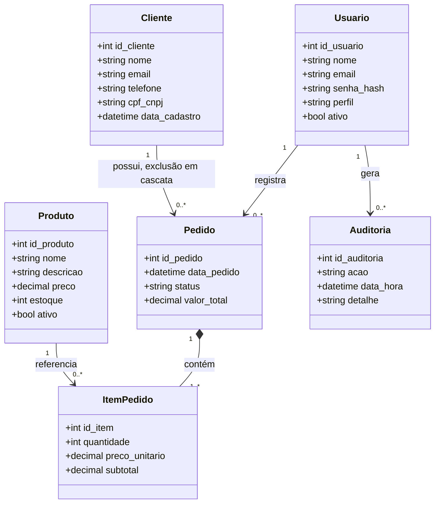
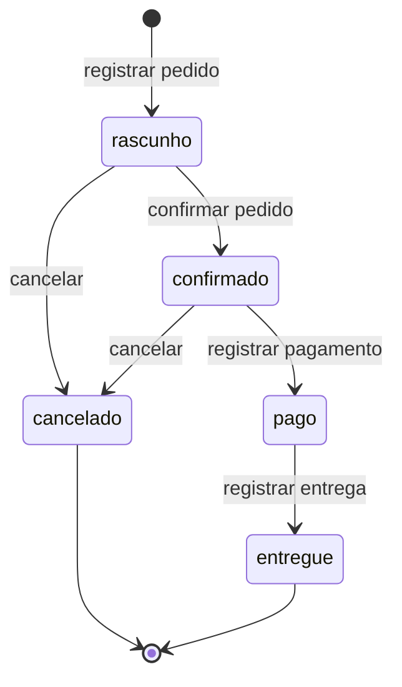
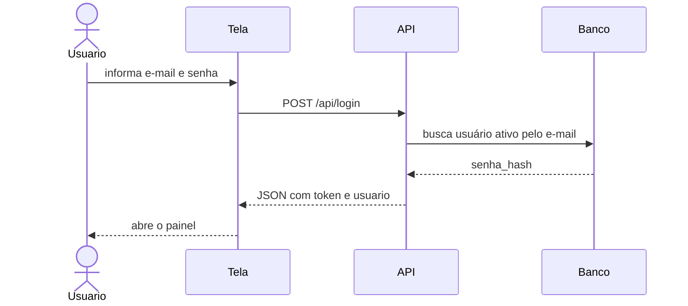

# Sistema Comercial

Sistema web para o controle de clientes, produtos e pedidos de uma loja. A aplicação oferece uma tela de acesso, um painel inicial e o cadastro operacional usado no dia a dia do balcão.

O painel inicial resume a operação com três indicadores: total de clientes cadastrados, quantidade de produtos ativos em estoque e faturamento do mês corrente.

## Tecnologias

- Node.js com módulos ES
- Express 5
- PostgreSQL
- Páginas HTML, CSS e JavaScript em `public/`
- Autenticação por JWT

## Como executar

1. Instale [Node.js](https://nodejs.org/) e o PostgreSQL.
2. Crie o banco `sistema_comercial`.
3. Execute o script `database/sql.sql` com o banco vazio (ele cria as tabelas e os dados de demonstração).
4. Copie as variáveis abaixo para um arquivo `.env` na raiz do projeto e preencha a senha do PostgreSQL:

```env
PORT=3000
DB_HOST=localhost
DB_PORT=5432
DB_USER=postgres
DB_PASSWORD=sua_senha
DB_NAME=sistema_comercial
JWT_SECRET=troque_por_uma_chave_secreta_longa_e_aleatoria

# Opcional: caminhos do certificado para subir em HTTPS (veja RNF07)
# HTTPS_KEY=certs/chave.pem
# HTTPS_CERT=certs/certificado.pem
```

5. Instale as dependências e suba a aplicação:

```bash
npm install
npm start
```

Durante o desenvolvimento, `npm run dev` sobe com o `nodemon`, que reinicia o servidor a cada arquivo salvo.

6. Abra `http://localhost:3000/login`.

O processo só passa a escutar a porta depois que a conexão com o banco é confirmada. Se o PostgreSQL estiver parado ou o `.env` estiver incorreto, o servidor registra o erro e encerra. Sem `JWT_SECRET` ele também não sobe.

## Usuários de demonstração

O script do banco já grava dois usuários ativos.

| Nome | E-mail | Senha | Perfil |
| --- | --- | --- | --- |
| Administrador | admin@comercial.com | admin123 | admin |
| Funcionário | funcionario@comercial.com | func123 | funcionario |

Usuário com `ativo = false` não consegue entrar. E-mail ou senha incorretos devolvem a mesma mensagem, sem indicar qual dos dois campos falhou.

## Estrutura do projeto

```text
projeto-manutencao/
├── database/
│   └── sql.sql
├── public/
│   ├── login.html
│   ├── index.html
│   ├── script.js
│   └── style.css
├── src/
│   ├── server.js
│   ├── routes.js
│   ├── auth.js
│   ├── erros.js
│   └── database.js
├── .env
└── package.json
```

A interface estática fica em `public/`. As rotas de negócio ficam em `src/routes.js` e são publicadas sob o prefixo `/api`.

## Arquitetura

O navegador conversa com uma API HTTP em JSON. O login valida o e-mail e a senha e devolve um token JWT, válido por 2 horas, junto com os dados do usuário. A tela guarda o token e o usuário no `localStorage` e envia o token no cabeçalho `Authorization` nas chamadas seguintes.

A gravação de um pedido usa uma transação: o pedido, os itens e a baixa de estoque são confirmados juntos. Qualquer falha desfaz a operação inteira.

## Diagramas UML

### Diagrama de classes



`perfil` aceita apenas `admin` ou `funcionario`. O status do pedido aceita `rascunho`, `confirmado`, `pago`, `entregue` e `cancelado`.

### Diagrama de estados do pedido



Pedido `pago` ou `entregue` é final: a API recusa o cancelamento e o estoque não é alterado.

### Sequência do login



## Modelo de dados

| Tabela | Papel | Colunas principais |
| --- | --- | --- |
| `usuarios` | Quem acessa o sistema | `id_usuario`, `nome`, `email`, `senha_hash`, `perfil`, `ativo` |
| `clientes` | Cadastro de clientes | `id_cliente`, `nome`, `email`, `telefone`, `cpf_cnpj`, `data_cadastro` |
| `produtos` | Catálogo e saldo | `id_produto`, `nome`, `descricao`, `preco`, `estoque`, `ativo` |
| `pedidos` | Cabeçalho da venda | `id_pedido`, `id_cliente`, `id_usuario`, `data_pedido`, `status`, `valor_total` |
| `itens_pedido` | Linhas da venda | `id_item`, `id_pedido`, `id_produto`, `quantidade`, `preco_unitario`, `subtotal` |
| `auditoria` | Histórico das operações | `id_auditoria`, `id_usuario`, `acao`, `data_hora`, `detalhe` |

Regras estruturais adotadas no banco:

- `clientes.email` e `clientes.cpf_cnpj` são obrigatórios e únicos.
- `produtos.preco` precisa ser maior que zero. `produtos.estoque` pode ficar negativo.
- A exclusão de um cliente remove os pedidos dele e, em seguida, os itens desses pedidos.
- `clientes.cpf_cnpj` aceita apenas 11 ou 14 dígitos, sem pontuação.
- `itens_pedido` guarda quantidade, preço unitário e subtotal **do momento da venda**. Mudar o preço de um produto depois não altera pedidos já registrados.
- Produto desativado continua na tabela (com `ativo = false`) para não quebrar o histórico dos pedidos antigos.

O script de demonstração carrega os clientes João Pereira, Maria Oliveira, Pedro Santos e Ana Costa, e os produtos Notebook (R$ 3.500,00), Mouse (R$ 80,00), Teclado (R$ 120,00), Monitor (R$ 950,00), Headset (R$ 180,00) e Webcam (R$ 250,00).

## Requisitos funcionais

### RF01 — Acessar o sistema

O usuário entra em `/login` com e-mail e senha. Usuário inativo não entra. Credencial inválida gera uma única mensagem genérica.

### RF02 — Respeitar o perfil

O administrador consulta, cadastra, edita, exclui clientes, desativa produtos e cancela pedidos. O funcionário consulta, cadastra e edita, e a API responde `403` quando ele tenta excluir cliente, desativar produto ou cancelar pedido.

### RF03 — Cadastrar cliente

O cadastro exige nome, e-mail e CPF/CNPJ. O telefone é opcional. O CPF deve ter 11 dígitos e o CNPJ, 14. E-mail repetido ou documento repetido devolve `409`.

### RF04 — Consultar e editar cliente

A grade de clientes exibe nome, e-mail, telefone e CPF/CNPJ, em ordem de cadastro. A edição altera nome, e-mail, telefone e documento do cliente escolhido.

### RF05 — Excluir cliente

A exclusão do cliente remove também os pedidos vinculados e os itens desses pedidos. Os produtos de pedidos que ainda estavam em `rascunho` ou `confirmado` voltam para o estoque antes da exclusão, como num cancelamento.

### RF06 — Manter o catálogo de produtos

O usuário cadastra e edita produto com nome, descrição, preço e estoque. O preço precisa ser maior que zero. A listagem mostra somente produtos ativos, ordenados pelo identificador.

### RF07 — Desativar produto

A ação **Desativar** marca o produto como fora de linha (`ativo = false`). Ele deixa de aparecer na listagem, não pode mais ser editado nem incluído em novos pedidos, mas continua no banco para que os pedidos antigos sigam mostrando o que foi vendido.

### RF08 — Registrar, consultar e acompanhar pedidos

O pedido informa um cliente já cadastrado e pelo menos um produto. O valor total mínimo é R$ 50,00. Quantidade maior que o estoque não impede o registro. Incluir o mesmo produto duas vezes no mesmo pedido devolve `409`.

A listagem mostra número, cliente, vendedor, data, status e total. O detalhe lista os produtos, as quantidades e os subtotais. A mudança de status é feita em `PUT /api/pedidos/:id/status`. O cancelamento usa `DELETE /api/pedidos/:id` e só é aceito nos status `rascunho` e `confirmado`.

## Requisitos não funcionais

### RNF01 — Persistência e partida

Os dados ficam no PostgreSQL, no banco `sistema_comercial`. A aplicação só começa a atender requisições depois de executar `SELECT NOW()` com sucesso.

### RNF02 — Proteção da senha

A senha é armazenada com bcrypt (custo 10, com salt próprio por usuário). A comparação no login usa o mesmo algoritmo, pela biblioteca `bcryptjs`.

### RNF03 — Execução

O comando oficial de subida é `npm start`. Na ausência de `PORT`, o processo escuta a porta `8080`.

### RNF04 — Paginação

As consultas de clientes, produtos, pedidos e auditoria aceitam `page` e `limit`. O padrão é 10 registros por página (máximo de 100), e a interface oferece os controles de página anterior e próxima. A resposta vem neste formato:

```json
{
  "dados": [],
  "pagina": 1,
  "limite": 10,
  "total": 4,
  "total_paginas": 1
}
```

### RNF05 — Idioma e moeda

Textos da interface e mensagens da API estão em português do Brasil. Valores monetários são apresentados em real (BRL).

### RNF06 — Auditoria

Cada inclusão, alteração e exclusão grava uma linha na tabela `auditoria`, com usuário, ação, data e detalhe. A consulta fica em `GET /api/auditoria`.

### RNF07 — Transporte

Em produção, toda comunicação com a API usa HTTPS: basta informar `HTTPS_KEY` e `HTTPS_CERT` no `.env` que o servidor sobe em HTTPS. Sem essas variáveis ele sobe em HTTP e avisa no console, o que serve apenas para desenvolvimento local.

### RNF08 — Consistência do pedido

A criação do pedido é transacional. Pedido, itens e movimentação de estoque são confirmados em conjunto ou desfeitos por completo.

## Regras de negócio

### RN01 — Operações por perfil

Somente o perfil `admin` pode excluir cliente, desativar produto e cancelar pedido. O perfil `funcionario` fica limitado à consulta, ao cadastro e à edição.

### RN02 — Identificação do cliente

E-mail e CPF/CNPJ são obrigatórios e únicos. O documento só é aceito com 11 dígitos (CPF) ou 14 dígitos (CNPJ), sem pontuação.

### RN03 — Produto fora de linha

Produto inativo não aparece na listagem e não pode ser incluído em um pedido novo.

### RN04 — Pedido mínimo

Todo pedido precisa de um cliente existente, de ao menos um item com quantidade inteira maior que zero e de valor total igual ou superior a R$ 50,00.

### RN05 — Estoque descoberto

Se a quantidade pedida for maior que o saldo, o pedido é aceito mesmo assim e o estoque do produto fica negativo até uma reposição posterior.

### RN06 — Cancelamento

Só é possível cancelar pedido em `rascunho` ou `confirmado`. O cancelamento devolve as quantidades ao estoque. Pedido `pago` ou `entregue` não pode ser cancelado.

## API

As rotas abaixo, exceto o login e a verificação de status, exigem o token JWT obtido no login.

| Método | Caminho | Comportamento |
| --- | --- | --- |
| `GET` | `/api/status` | Informa que o sistema está em funcionamento |
| `POST` | `/api/login` | Valida e-mail e senha e devolve o token JWT |
| `GET` | `/api/painel` | Indicadores do painel: clientes, produtos ativos em estoque e faturamento do mês |
| `GET` | `/api/clientes` | Lista clientes paginados |
| `POST` | `/api/clientes` | Cadastra cliente. `409` se e-mail ou documento já existir |
| `PUT` | `/api/clientes/:id` | Atualiza cliente. `404` se o id não existir |
| `DELETE` | `/api/clientes/:id` | Exclui cliente e os pedidos em cascata. `403` para funcionário |
| `GET` | `/api/produtos` | Lista produtos ativos paginados |
| `POST` | `/api/produtos` | Cadastra produto |
| `PUT` | `/api/produtos/:id` | Atualiza produto ativo. `404` se não existir |
| `DELETE` | `/api/produtos/:id` | Desativa o produto. `403` para funcionário |
| `GET` | `/api/pedidos` | Lista pedidos paginados, do mais recente para o mais antigo |
| `GET` | `/api/pedidos/:id` | Devolve o cabeçalho e os itens |
| `POST` | `/api/pedidos` | Registra pedido em `rascunho` |
| `PUT` | `/api/pedidos/:id/status` | Altera o status conforme o diagrama de estados |
| `DELETE` | `/api/pedidos/:id` | Cancela o pedido, quando o status permitir. `403` para funcionário |
| `GET` | `/api/auditoria` | Lista o histórico de operações, do mais recente para o mais antigo |

Códigos usados pela API:

- `200` para consulta, atualização e cancelamento concluídos
- `201` para cadastro concluído
- `400` para dados obrigatórios ausentes ou inválidos, pedido abaixo do valor mínimo, produto fora de linha, mudança de status fora do diagrama ou cancelamento não permitido
- `401` para token ausente, inválido ou expirado
- `403` para funcionário em operação exclusiva do administrador
- `404` para cliente, produto ou pedido inexistente
- `409` para e-mail ou documento de cliente já cadastrado, ou produto repetido no pedido
- `500` para falha inesperada

Exemplo de registro de pedido:

```json
{
  "id_cliente": 1,
  "itens": [
    { "id_produto": 2, "quantidade": 1 },
    { "id_produto": 3, "quantidade": 2 }
  ]
}
```

Exemplo de mudança de status:

```json
{
  "status": "pago"
}
```

---

## O que mudou nesta manutenção

Quando abri o projeto, o README descrevia um sistema e o código fazia outro. Muita coisa prometida aqui (perfis, auditoria, paginação, status de pedido, painel com números) simplesmente não existia, e algumas regras que existiam iam na direção contrária do que estava escrito. O trabalho foi colocar código e documentação para dizer a mesma coisa. Onde o próprio README pedia algo que ia prejudicar o sistema, eu corrigi o README, e explico o porquê logo abaixo.

Tudo foi testado num PostgreSQL de verdade: 58 verificações na API (login, perfis, validações, pedidos, cancelamento, cascata, auditoria) e um passeio pela interface com os dois usuários de demonstração, sem nenhum erro no console.

### Erros que corrigi

- **Ninguém conseguia entrar com os usuários do README.** O banco criava `Admin123!` e um tal de `carlos@comercial.com`, enquanto o README mandava usar `admin123` e `funcionario@comercial.com`. Agora o script grava exatamente os usuários da tabela de demonstração.
- **O funcionário podia fazer tudo.** Não havia nenhuma checagem de perfil: qualquer usuário logado excluía cliente, desativava produto e cancelava pedido. Agora a API responde `403` para o funcionário nessas três ações, e a tela nem mostra esses botões para ele.
- **Excluir cliente com pedidos dava erro.** A chave estrangeira não tinha cascata, então a API devolvia `409`. Agora o cliente sai junto com os pedidos e os itens, como pede o RF05.
- **O pedido era barrado por falta de estoque**, tanto na tela quanto na API, e o banco ainda proibia estoque negativo. O README (RN05) diz o contrário: o pedido entra e o saldo fica negativo até a reposição. Agora é assim, e a tela só avisa quem está vendendo que o estoque vai ficar negativo.
- **Produto repetido no pedido era somado em silêncio.** Agora a API devolve `409`, e a tela avisa antes de mandar.
- **Não havia valor mínimo de pedido.** Agora pedido abaixo de R$ 50,00 volta com `400`.
- **Os status do pedido eram outros** (`aberto`, `pago`, `cancelado`). Troquei para `rascunho → confirmado → pago → entregue`, com `cancelado` saindo de `rascunho` ou `confirmado`, como no diagrama de estados.
- **Dava para cancelar pedido pago.** A rota de cancelamento só recusava pedido já cancelado. Agora pedido `pago` ou `entregue` não pode ser cancelado, e o cancelamento usa `DELETE /api/pedidos/:id`, como está documentado (antes era `PATCH /pedidos/:id/cancelar`).
- **Cliente podia ser salvo sem e-mail e sem documento**, com CPF de qualquer tamanho e e-mail repetido. Agora nome, e-mail e CPF/CNPJ são obrigatórios, o documento precisa ter 11 ou 14 dígitos, e repetição devolve `409` com uma mensagem dizendo qual campo já existe. Na tela, pode digitar o CPF com pontos e traço que eles são removidos antes do envio.
- **Produto com preço zero era aceito.** Agora o preço precisa ser maior que zero, no banco e na API.
- **Login sem e-mail ou senha estourava `500`.** Agora volta `400` com uma mensagem clara.
- **Qualquer erro no pedido virava `400`**, até falha do banco. Agora cada situação tem o código certo (`400`, `404`, `409`) e só o que é realmente inesperado vira `500`.
- **Identificador inválido na URL** (ex.: `/api/clientes/abc`) estourava erro do PostgreSQL. Agora volta `400`.
- **JSON quebrado e rota inexistente** devolviam uma página HTML em inglês do Express. Agora a resposta é JSON e em português.
- **O servidor dependia da pasta de onde era iniciado** para achar o `public/`. Agora ele encontra a pasta sozinho.
- **Se o banco estivesse fora do ar**, o erro saía com a mensagem vazia. Agora o motivo aparece (ex.: `ECONNREFUSED`) e o processo encerra com código de erro.
- **`npm start` não existia**, apesar de o RNF03 dizer que é o comando oficial. Também ajustei a porta padrão para 8080 quando não há `PORT`, o `main` do `package.json` (apontava para um `index.js` inexistente) e passei o `nodemon` para `devDependencies`, porque ele só serve para desenvolvimento.

### O que criei

- **Painel com números de verdade:** total de clientes, produtos ativos com estoque e faturamento do mês (pedidos pagos ou entregues no mês atual), servidos pela nova rota `GET /api/painel`.
- **Auditoria completa:** tabela `auditoria`, registro automático de toda inclusão, alteração e exclusão (feito dentro da mesma transação da operação, então nunca fica um sem o outro), rota `GET /api/auditoria` e uma aba na tela para consultar.
- **Mudança de status do pedido:** rota `PUT /api/pedidos/:id/status`, que só aceita os passos do diagrama, e botões na tela como "Confirmar", "Registrar pagamento" e "Registrar entrega".
- **Paginação** em clientes, produtos, pedidos e auditoria, com botões de anterior e próxima.
- **Grade de clientes com a coluna CPF/CNPJ**, e grade de pedidos com a coluna **Vendedor**, como pedem o RF04 e o RF08.
- **Detalhe do pedido mais completo:** vendedor, data e hora, preço unitário de cada item.
- **Total estimado ao montar o pedido**, com aviso quando ainda não chegou ao mínimo.
- **Rota `/login`**, que abre a tela de acesso (antes só `/login.html` funcionava).
- **Suporte a HTTPS:** com `HTTPS_KEY` e `HTTPS_CERT` no `.env`, o servidor sobe em HTTPS.
- **`src/erros.js`**, um tratador central de erros, para cada rota não ter que repetir o mesmo `try/catch`.

### Onde mudei o README em vez do código, e por quê

Alguns pontos do README pediam algo que deixaria o sistema pior. Nesses casos mantive (ou fiz) o código do jeito seguro e ajustei o texto:

- **Senha com SHA-256 sem salt (RNF02).** Isso é inseguro: dois usuários com a mesma senha ficariam com o mesmo hash, e o SHA-256 é rápido demais, o que facilita ataques de força bruta. O projeto já usava **bcrypt**, que é o correto, então mantive o bcrypt e corrigi o requisito.
- **"Excluir" produto apagando o registro (RF07).** Isso batia de frente com o RN03, o RF02 e o próprio modelo de dados, que falam em *desativar*. E apagar de verdade quebraria todo pedido antigo que tivesse aquele produto. Ficou a desativação.
- **Recalcular pedidos quando o preço do produto muda.** Isso faria um pedido já pago mudar de valor depois de fechado. O pedido guarda o preço do dia da venda, que é o que se espera de um histórico de vendas.
- **HTTPS obrigatório até no desenvolvimento (RNF07).** Exigir certificado na máquina de cada desenvolvedor só atrapalha. O HTTPS fica ligado por configuração (obrigatório em produção), e em desenvolvimento o servidor avisa no console que está em HTTP.

### Decisões que tomei onde o README não dizia nada

- Ao excluir um cliente, os produtos dos pedidos dele que ainda estavam em `rascunho` ou `confirmado` voltam ao estoque, do mesmo jeito que num cancelamento. Pedidos pagos ou entregues não devolvem nada, porque a mercadoria já saiu.
- "Faturamento do mês" considera apenas pedidos `pago` ou `entregue`, pela data do pedido (o banco não guarda a data do pagamento).
- O cancelamento não passa pelo `PUT /status`: quem tentar mudar o status para `cancelado` por ali recebe uma orientação para usar o `DELETE`, que é a rota que confere o perfil e devolve o estoque.
